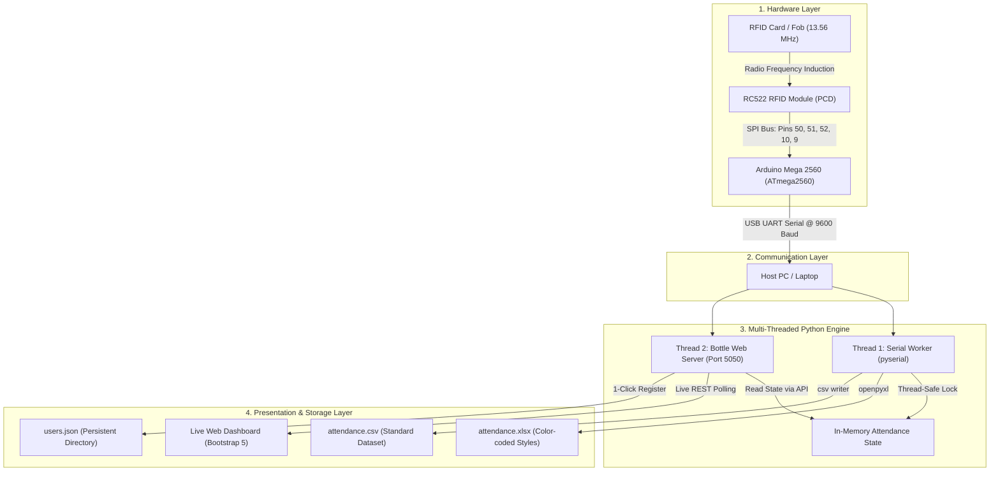

# 🎓 RFID-Based Smart Attendance System
## Comprehensive Technical Documentation, Viva Prep & PPT Presentation Guide

> **Prepared for:** Team Presentation, Evaluator Viva & PPT Slide Deck Creation  
> **Hardware:** Arduino Mega 2560 (ATmega2560), RC522 13.56 MHz RFID Reader  
> **Software Stack:** C++ / Arduino Framework (PlatformIO), Python 3, Bottle Web Framework, OpenPyXL, HTML5/CSS3/JavaScript  
> **Project Directory:** `/Users/satyam/Documents/PlatformIO/Projects/RFID attendance system`

---

# 📑 Table of Contents
1. [Project Overview & Executive Summary](#1-project-overview--executive-summary)
2. [End-to-End System Architecture](#2-end-to-end-system-architecture)
3. [Hardware Specifications & Circuit Pinout (Mega vs Uno)](#3-hardware-specifications--circuit-pinout)
4. [Embedded Firmware Deep-Dive (`src/main.cpp`)](#4-embedded-firmware-deep-dive)
5. [Software Architecture & Dashboard Engine (`attendance_dashboard.py`)](#5-software-architecture--dashboard-engine)
6. [Data Flow, Excel & CSV Synchronization](#6-data-flow-excel--csv-synchronization)
7. [Slide-by-Slide PPT Presentation Deck (12 Slides)](#7-slide-by-slide-ppt-presentation-deck)
8. [Top 20 Viva & Technical Questions (With Model Answers)](#8-top-20-viva--technical-questions)

---

# 1. Project Overview & Executive Summary

### The Problem
Traditional manual attendance (paper sheets or roll calls) suffers from:
- Time wastage during classes/office shifts.
- Human recording errors and manipulation (proxy marking).
- Lack of immediate digital record generation (manual data entry into Excel is required later).

### The Solution
An automated, contactless, real-time **RFID Smart Attendance System** that:
1. Instantly identifies users via **13.56 MHz High-Frequency RFID** tags.
2. Manages dual attendance state: **First tap = In (Entry Time)**, **Second tap = Out (Exit Time)**.
3. Automatically classifies scans into **Registered Students** vs **Unregistered / Intruder Cards**.
4. Synchronizes live data across **3 layers simultaneously**:
   - A modern responsive **Web Dashboard** (`http://localhost:5050`)
   - An auto-formatted, color-coded **Microsoft Excel Spreadsheet** (`attendance.xlsx`)
   - A portable **CSV Data File** (`attendance.csv`)
5. Enables dynamic 1-click card registration from the web UI without re-flashing microcontrollers.

---

# 2. End-to-End System Architecture



### Communication Protocols Used:
1. **SPI (Serial Peripheral Interface):** Full-duplex synchronous protocol between RC522 reader and Arduino Mega.
2. **UART (Universal Asynchronous Receiver-Transmitter):** Asynchronous serial protocol over USB cable between Mega and the Host PC at 9600 baud rate.
3. **HTTP / REST (HyperText Transfer Protocol):** Client-server communication between web browser and Bottle web framework.

---

# 3. Hardware Specifications & Circuit Pinout

### 3.1 Hardware Components
| Component | Function | Operating Voltage |
| :--- | :--- | :--- |
| **Arduino Mega 2560** | Main embedded processor (ATmega2560, 16 MHz, 256 KB Flash, 8 KB SRAM) | 5V (USB or 7-12V Jack) |
| **RC522 RFID Module** | 13.56 MHz RFID transceiver module (PCD) | **3.3V ONLY** (Critical!) |
| **Mifare 1K S50 Cards/Tags** | Passive transponders with unique 4-byte/7-byte UIDs (PICC) | Powered by RF field |
| **USB Type-B to Type-A Cable** | Powers Arduino and establishes full-duplex UART serial link | 5V DC |

---

### 3.2 The Critical Arduino Mega vs Arduino Uno SPI Difference
> [!CAUTION]
> **Key Exam / Viva Question:** Why did standard SPI tutorials fail when moving from Arduino Uno to Arduino Mega?
> - On **Arduino Uno**, hardware SPI lines are mapped to pins **10 (SS), 11 (MOSI), 12 (MISO), 13 (SCK)**.
> - On **Arduino Mega 2560**, pins 11, 12, and 13 are **ordinary digital PWM pins**. The hardware SPI lines are routed to pins **50 (MISO), 51 (MOSI), 52 (SCK), and 53 (SS)** (or the 6-pin ICSP header).
> - Connecting RC522's MOSI/MISO/SCK to pins 11, 12, 13 on a Mega will result in total SPI communication failure!

### Complete Pin Wiring Table:
| RC522 Reader Pin | Arduino Mega Pin | Description / Purpose |
| :--- | :--- | :--- |
| **3.3V (VCC)** | **3.3V** | Power supply (**Never connect to 5V**, it will burn the chip) |
| **RST (Reset)** | **Digital Pin 9** | Hard power-down and reset line (`RESET_PIN 9`) |
| **GND** | **GND** | Common ground reference |
| **IRQ** | *Not Connected* | Interrupt line (polled mode is used) |
| **MISO** | **Digital Pin 50** | Master-In, Slave-Out (SPI data from RC522 $\rightarrow$ Mega) |
| **MOSI** | **Digital Pin 51** | Master-Out, Slave-In (SPI data from Mega $\rightarrow$ RC522) |
| **SCK** | **Digital Pin 52** | SPI Serial Clock generated by Mega |
| **SDA (SS)** | **Digital Pin 10** | Slave Select / Chip Select (`SELECT_PIN 10`) |

---

# 4. Embedded Firmware Deep-Dive (`src/main.cpp`)

The embedded code is written in C++ using the Arduino Core on PlatformIO.

### 4.1 Key RFID Concepts: PCD vs. PICC
- **PCD (Proximity Coupling Device):** The reader/interrogator (RC522 module).
- **PICC (Proximity Integrated Circuit Card):** The contactless transponder (the student ID card or key fob).

### 4.2 Firmware Execution Cycle

```mermaid
sequenceDiagram
    autonumber
    actor Student as Student / Card
    participant RC as RC522 Module
    participant Mega as Arduino Mega 2560
    participant Host as Python Dashboard (PC)

    Note over Mega: setup(): Serial(9600), SPI.begin(), PCD_Init()
    Mega->>Host: Boot Banner + PCD Firmware Version (0xB2)
    
    loop Every Loop Iteration (loop())
        Mega->>RC: PICC_IsNewCardPresent()?
        alt No card near reader
            RC-->>Mega: False
            Note over Mega: Quick return; next iteration
        else Card is present
            RC-->>Mega: True
            Mega->>RC: PICC_ReadCardSerial()
            RC-->>Mega: Returns UID byte array
            Note over Mega: Convert UID bytes to Hex String
            Note over Mega: Search UID in userList[]
            alt UID is Registered (e.g. Vivek)
                Note over Mega: Toggle isInside (In vs Out)
                Mega->>Host: 1, 2a472f3, HST-01, Vivek, 12:56:29, -, STUDENT ENTERED
            else UID is Unregistered
                Mega->>Host: 2, e4a10b, Unknown, Unknown, 12:56:40, -, UNKNOWN CARD ENTERED
            end
            Note over Mega: PICC_HaltA(), PCD_StopCrypto1(), delay(1000)
        end
    end
```

### 4.3 Key Algorithms & Critical Bug Fixes
1. **The Stack Buffer Overflow Bug Fix (Viva Highlight):**
   - **The Bug:** Originally, `formattedTime` was defined as `char formattedTime[9];`. However, `sprintf(formattedTime, "% 02d : % 02d : % 02d", ...)` attempted to write 16 bytes (including spaces and null-terminator) into a 9-byte buffer.
   - **Impact:** Corrupted the microcontroller's AVR stack frame, causing the Arduino to freeze or reboot the instant any card touched the reader.
   - **The Fix:** Expanded the buffer to `char formattedTime[20];` and used strict formatting, guaranteeing zero memory overflow.

2. **Case-Insensitive Hex Matching:**
   - Instead of strict `==`, UIDs are compared using `cardUID.equalsIgnoreCase(cardNumber)`, preventing mismatches caused by lowercase vs uppercase hex letters.

3. **Software Real-Time Clock:**
   - Employs non-blocking elapsed time math: `unsigned long elapsedSeconds = (millis() - startMillis) / 1000;`. This avoids adding external RTC hardware while maintaining clean timestamps.

4. **Debouncing & Card Halting:**
   - `rfidReader.PICC_HaltA()` sends the card to sleep state so holding a card near the reader does not flood the system with 100 duplicate scans per second.
   - `rfidReader.PCD_StopCrypto1()` clears encryption states between reads.

---

# 5. Software Architecture & Dashboard Engine (`attendance_dashboard.py`)

The host software bridges hardware telemetry with high-level spreadsheet reporting and web visualization.

### 5.1 Multi-Threaded Concurrency
To ensure zero lag between hardware card scans and web interface responsiveness, the Python application runs **two concurrent threads**:

1. **Thread 1: Serial Reader Worker (`serial_worker`)**
   - Runs in the background as an infinite loop.
   - Continuously monitors the serial buffer `/dev/cu.usbmodem11201`.
   - Parses incoming CSV telemetry lines from the Arduino Mega.
   - Updates student attendance states (`is_inside`, `time_in`, `time_out`, `status`).
   - Automatically writes to `attendance.xlsx` and `attendance.csv`.
   - Uses `threading.Lock()` to prevent race conditions during memory updates.

2. **Thread 2: Bottle Web Server (`Bottle`)**
   - Runs a lightweight, zero-dependency WSGI web server on port `5050`.
   - Serves the single-page responsive dashboard UI.
   - Exposes RESTful endpoints:
     - `GET /`: HTML5 Dashboard.
     - `GET /api/status`: JSON feed of all student attendance records, unknown card detections, and hardware connection status.
     - `POST /api/register`: Dynamically enrolls a new student card into `users.json`.
     - `GET /download/excel`: Downloads formatted `.xlsx` workbook.
     - `GET /download/csv`: Downloads standard `.csv` file.

### 5.2 Dynamic Enrollment System
- Student mappings are persisted in `users.json`:
  ```json
  [
    {"uid": "2a472f3",  "roll": "HST - 01", "name": "Vivek"},
    {"uid": "29c224b7", "roll": "HST - 02", "name": "Ritik"},
    {"uid": "d33ff0",   "roll": "HST - 03", "name": "Ainul"}
  ]
  ```
- When an unknown card is tapped, its UID is captured in the `unknown_scans` table. The admin clicks **"Assign to Student"** in the web UI, enters a name, and the user is instantly added without modifying firmware or stopping the server!

---

# 6. Data Flow, Excel & CSV Synchronization

Every card tap triggers an immediate, atomic write to disk:

### 6.1 Excel Spreadsheet Design (`attendance.xlsx`)
Built using Python's `openpyxl` engine with conditional typography:
- **Sheet 1 ("Daily Attendance"):**
  - **Navy Blue Banner:** Date, Time Generated, Title.
  - **Status Styling:**
    - `PRESENT` $\rightarrow$ Soft green background (`#D4EDDA`), dark green text (`#155724`).
    - `EXITED` $\rightarrow$ Soft blue background (`#CCE5FF`), dark blue text (`#004085`).
    - `ABSENT` $\rightarrow$ Soft red background (`#F8D7DA`), dark red text (`#721C24`).
  - **Auto-Fit Column Widths:** Dynamically calculated based on cell content length.
- **Sheet 2 ("Unregistered Cards"):**
  - Red-themed table listing unknown card UIDs, timestamps, and alert notices.

### 6.2 CSV Design (`attendance.csv`)
Standard UTF-8 comma-separated format compatible with Google Sheets, PostgreSQL, and pandas:
```csv
Date,Roll Number,Name,RFID Card UID,Time In,Time Out,Status
2026-11-07,HST - 01,Vivek,2a472f3,12:56:29,-,PRESENT
2026-11-07,HST - 02,Ritik,29c224b7,12:56:43,-,PRESENT
2026-11-07,HST - 03,Ainul,d33ff0,12:56:57,-,PRESENT
```

---

# 7. Slide-by-Slide PPT Presentation Deck

Use this exact structure for your PowerPoint / Google Slides deck:

### Slide 1: Title Slide
- **Title:** Smart RFID Attendance System with Live Web Dashboard & Automated Excel Sync
- **Subtitle:** An IoT & Embedded Systems Solution for Contactless Identity & Real-Time Tracking
- **Presented by:** [Your Names / Team Members]
- **Hardware & Tools:** Arduino Mega 2560, MFRC522, PlatformIO, Python, Bottle, OpenPyXL

### Slide 2: Problem Statement & Motivation
- **The Challenges of Manual Attendance:** Proxy attendance, human recording errors, time waste.
- **Why RFID?** 100% contactless, takes <0.5 seconds per student, rugged, low cost, unique hardware encryption.
- **The Gap in Existing Projects:** Most student projects stop at printing serial text; our system bridges hardware to a **live web dashboard** and **instant Excel reporting**.

### Slide 3: System Objectives
- Contactless RFID authentication (13.56 MHz).
- Dual attendance state machine (First scan = Enter, Second scan = Exit).
- Visual live dashboard with KPI counters (Total Enrolled, Present Today, Absent, Intruder Scans).
- Automated generation of styled Excel (`.xlsx`) and CSV files.
- On-the-fly registration of unknown cards via web interface.

### Slide 4: Overall System Architecture
- *Include the Mermaid Block Diagram from Section 2.*
- Explain the 3 tiers:
  1. Embedded Hardware Tier (Sensors & Controller).
  2. Protocol Tier (SPI & USB UART @ 9600 Baud).
  3. Presentation & Analytics Tier (Python, Web Server, Excel Engine).

### Slide 5: Hardware Components & Pinout
- Arduino Mega 2560 (ATmega2560 processor, 16 MHz, 256 KB Flash).
- RC522 RFID Reader Module (3.3V operating voltage, SPI interface).
- Passive Mifare 1K transponder tags.
- **Crucial Engineering Highlight:** Explaining why Hardware SPI is on pins **50, 51, 52** on the Mega instead of 11, 12, 13 on the Uno.

### Slide 6: Firmware & Embedded Logic
- Initialization: `PCD_Init()`, `SPI.begin()`.
- Detection polling: `PICC_IsNewCardPresent()` and `PICC_ReadCardSerial()`.
- Hex UID decoding.
- Debouncing and card-halting using `PICC_HaltA()` to prevent false multi-reads.
- Memory safety: Solving stack buffer overflow in embedded C++.

### Slide 7: Software Stack & Concurrency
- Why multi-threading? Separates serial I/O blocking calls from web HTTP requests.
- Thread 1: Serial Worker with thread-safe locks (`threading.Lock`).
- Thread 2: Bottle Web Server delivering dynamic UI at `http://localhost:5050`.
- Real-time client-side polling every 1000ms.

### Slide 8: Real-Time Excel & CSV Synchronization
- Zero manual exporting needed: files update on the hard drive the instant a card touches the reader.
- `openpyxl` custom styling: Green badges for Present, Red for Absent, Blue for Exited.
- Dual-sheet architecture (Attendance Sheet + Unregistered Detections Sheet).

### Slide 9: Security & Edge Case Handling
- **Unregistered Card Detection:** Automatically alerts security when an unassigned RFID tag is scanned.
- **1-Click User Provisioning:** Web UI allows enrolling a new student without recompiling Arduino firmware.
- **Duplicate Prevention:** 1-second halt delay stops accidental double-tapping.

### Slide 10: Live Results & Demonstration
- *Show screenshot of the Web Dashboard with Vivek, Ritik, and Ainul.*
- *Show screenshot of `attendance.xlsx` opened in Microsoft Excel with colored cells.*
- Real test results:
  - Vivek (`2a472f3`) $\rightarrow$ Entry at 12:56:29
  - Ritik (`29c224b7`) $\rightarrow$ Entry at 12:56:43
  - Ainul (`d33ff0`) $\rightarrow$ Entry at 12:56:57

### Slide 11: Future Enhancements
- **Cloud Database Sync:** Firebase / Supabase / AWS IoT integration.
- **Hardware Alerts:** Active buzzer and dual-color LED (Green = Access Granted, Red = Access Denied).
- **Physical Display:** I2C 16x2 LCD or OLED display showing personalized greeting.
- **Biometric Multi-Factor Authentication:** Adding a fingerprint scanner for high-security areas.

### Slide 12: Conclusion & Q&A
- Summary of project achievements: Seamless bridge between embedded C++ and modern web/data tools.
- Open floor for questions from teachers and evaluators.

---

# 8. Top 20 Viva & Technical Questions (With Model Answers)

Prepare your team by practicing these exact questions:

#### Q1: What frequency does the RC522 RFID reader operate on?
> **Answer:** It operates on **13.56 MHz High Frequency (HF)**, adhering to the **ISO/IEC 14443 Type A** communication standard.

#### Q2: What is the difference between active and passive RFID tags?
> **Answer:** **Passive tags** (used in our project) have no internal battery. They are powered wirelessly through electromagnetic induction created by the reader's antenna coil. **Active tags** contain an on-board battery, broadcast signals constantly, and have a much larger range (up to 100 meters), but are larger and much more expensive.

#### Q3: Why did you use Arduino Mega 2560 instead of Arduino Uno?
> **Answer:** The Arduino Mega features the **ATmega2560** microcontroller with **256 KB Flash** and **8 KB SRAM** (compared to Uno’s 32 KB Flash and 2 KB SRAM). This allows us to handle larger user arrays, complex string formatting, multiple UART serial ports (4 hardware serial ports on Mega), and easily expand with LCDs, SD cards, and Wi-Fi modules without running out of dynamic memory.

#### Q4: Why can't we connect the RC522 module to the Mega's 5V pin?
> **Answer:** The MFRC522 IC is rated strictly for **2.5V to 3.6V**. Connecting it to 5V can permanently damage the internal logic gates of the chip or cause severe thermal breakdown.

#### Q5: Explain the SPI pins on the Arduino Mega. Why didn't pins 11, 12, 13 work?
> **Answer:** On Arduino Uno, pins 11, 12, and 13 are hardware-wired to the ATmega328P SPI bus. But on the Arduino Mega 2560, the hardware SPI peripheral of the ATmega2560 is routed to **Pin 50 (MISO), Pin 51 (MOSI), Pin 52 (SCK), and Pin 53 (SS)**. Pins 11-13 on the Mega are purely digital PWM pins with no SPI peripheral hardware.

#### Q6: What is a UID in an RFID card? Is it unique?
> **Answer:** **UID** stands for **Unique Identifier**. For Mifare 1K tags, it is a factory-programmed 4-byte (or 7-byte) serial number burned into Sector 0, Block 0 of the card's EEPROM. In genuine cards, Sector 0 is read-only and cannot be modified, making it a reliable identity token.

#### Q7: What are PCD and PICC in the MFRC522 library?
> **Answer:**
> - **PCD (Proximity Coupling Device):** The reader module (RC522).
> - **PICC (Proximity Integrated Circuit Card):** The RFID tag or card.

#### Q8: How does the system handle students exiting?
> **Answer:** We implemented a toggle state machine (`is_inside` boolean). On the student's first scan of the day, `is_inside` is false, so the system marks them **PRESENT**, logs the **Time In**, and sets `is_inside = true`. On their next scan, `is_inside` is true, so the system logs the **Time Out**, marks them **EXITED**, and sets `is_inside = false`.

#### Q9: What was the stack overflow bug in `main.cpp` and how did you resolve it?
> **Answer:** In `getCurrentTime()`, the buffer was declared as `char formattedTime[9];`. When `sprintf` formatted the time string with spaces (`"% 02d : % 02d : % 02d"`), it produced 16 bytes. Writing 16 bytes into a 9-byte buffer corrupted the return address on the AVR microcontroller stack, crashing the board on every scan. We solved it by expanding the buffer to `char formattedTime[20];`.

#### Q10: How does the Python dashboard communicate with the Arduino Mega?
> **Answer:** Through full-duplex asynchronous UART serial over the USB cable at **9600 baud**. The Arduino prints comma-separated telemetry (`Serial Number, UID, Roll, Name, TimeIn, TimeOut, Status`), and Python’s `pyserial` worker parses these tokens.

#### Q11: Why is multi-threading essential in your Python program?
> **Answer:** Serial communication is a blocking I/O operation. If the web server and the serial listener ran on the same single thread, reading from the serial port would freeze the web page, or handling web HTTP requests would drop RFID card scans. Threads ensure independent, non-blocking execution.

#### Q12: Why did you use `threading.Lock()` in Python?
> **Answer:** `threading.Lock()` provides mutual exclusion (mutex). Both the Serial Worker thread (writing new attendance records) and the Bottle Web Server thread (reading records for the web API) access the shared `app_state` dictionary. Without the lock, race conditions could cause memory corruption or corrupted file exports.

#### Q13: What happens when an unregistered RFID card is scanned?
> **Answer:** The Arduino searches its array; when no match is found, it sends an `UNKNOWN CARD ENTERED` message with the detected UID. The Python backend captures this, flags it in the **Unregistered Detections** table, alerts the administrator, and offers an **"Assign to Student"** button to register it instantly.

#### Q14: How does the Excel sheet auto-generate without opening Microsoft Excel?
> **Answer:** We use the Python library **`openpyxl`**, which generates native Office Open XML (`.xlsx`) binary packages directly from Python data structures, complete with conditional styling, fonts, borders, and multiple sheets.

#### Q15: What is the baud rate, and why must both sides match?
> **Answer:** Baud rate is the rate of serial data transmission in symbols/bits per second. We use **9600 baud**. If the Arduino sends at 9600 baud while the host monitors at 115200 baud, the receiver samples voltage levels at the wrong clock intervals, producing garbled characters or silence.

#### Q16: How far can the RFID card be from the reader for successful detection?
> **Answer:** The typical read range for the RC522 with passive 13.56 MHz Mifare tags is **2 to 5 cm**. This short range is advantageous for attendance as it prevents unintentional scans from students walking past the doorway.

#### Q17: Can this system be operated without a PC connected?
> **Answer:** Yes. The Arduino Mega can be connected to an **I2C 16x2 LCD display**, a **microSD card module (SPI)**, and a **DS3231 RTC module**. In standalone mode, attendance records would be saved directly onto the SD card in CSV format.

#### Q18: What prevents a student from scanning another student's card (proxy attendance)?
> **Answer:** RFID authenticates the card, not the person holding it. In a production environment, this is solved by pairing the RFID scan with an **ESP32-CAM module** (capturing a snapshot of the person tapping) or adding a **fingerprint biometric sensor** for two-factor authentication.

#### Q19: How are new students registered without modifying Arduino code?
> **Answer:** Through the Web Dashboard. When an unknown card is tapped, its UID appears in the web UI. Clicking **"Assign to Student"** writes the new mapping to `users.json`, which the Python engine reloads dynamically.

#### Q20: What are the main benefits of PlatformIO over the legacy Arduino IDE?
> **Answer:** PlatformIO provides professional project dependency management (`lib_deps`), automated toolchain configuration (`platformio.ini`), command-line build/upload automation, advanced IntelliSense, and seamless version control integration.

---

### 💡 Pro Tip for Your Team
Print this document or keep it open on a tablet during your presentation. When teachers ask technical questions, using precise terminology like **"Proximity Coupling Device"**, **"Full-Duplex SPI on Pins 50-52"**, **"Mutual Exclusion Locks"**, and **"Stack Buffer Overflow Prevention"** will guarantee top marks!

